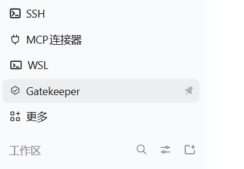
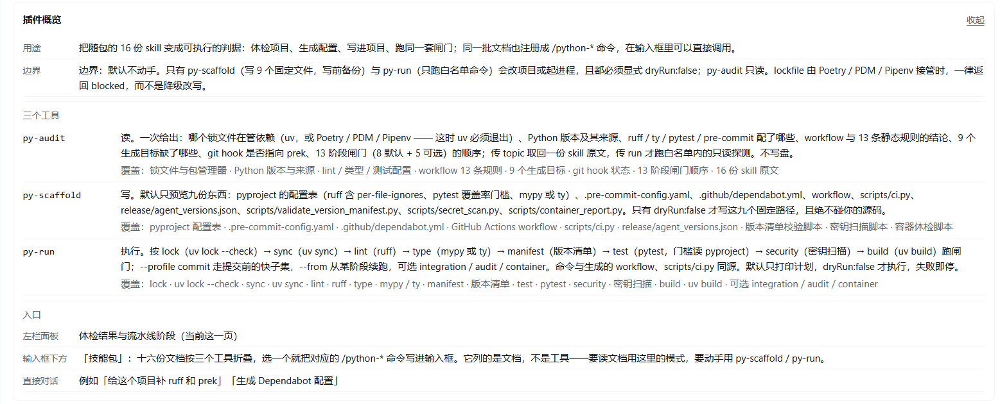
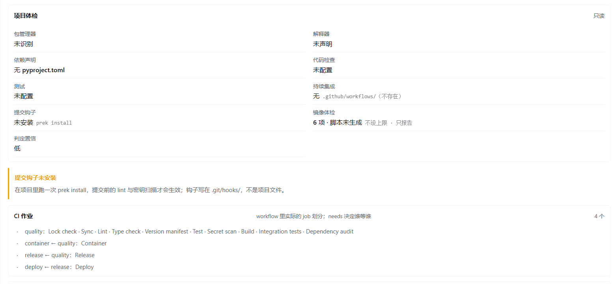
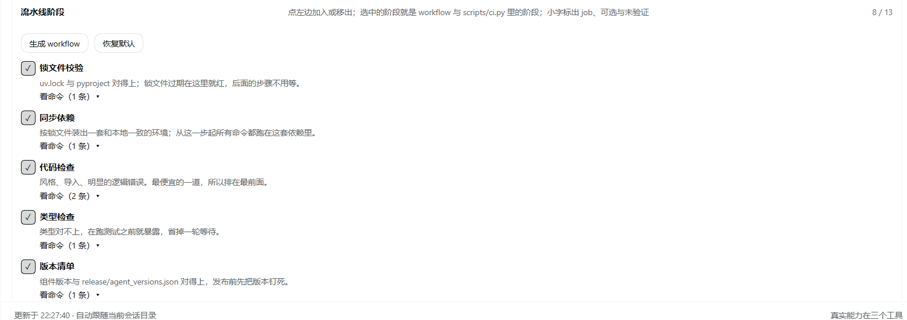
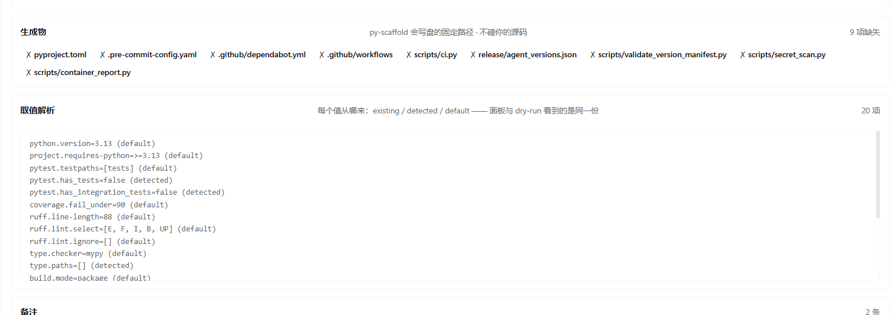
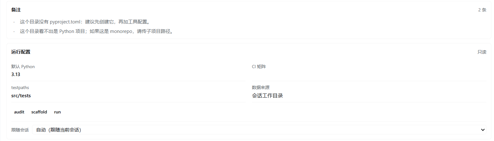
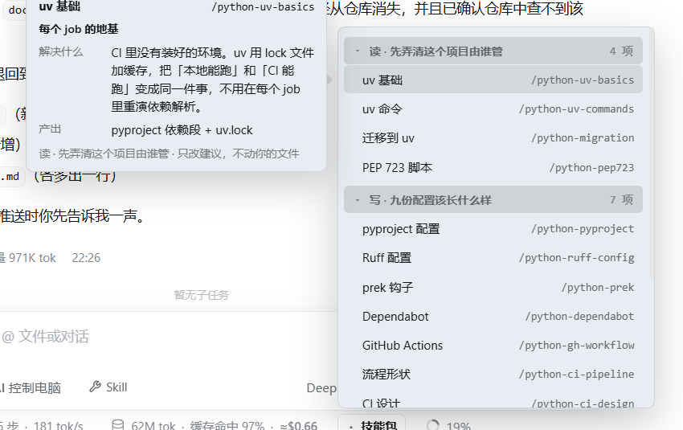
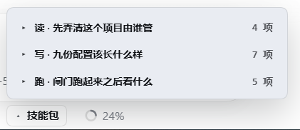
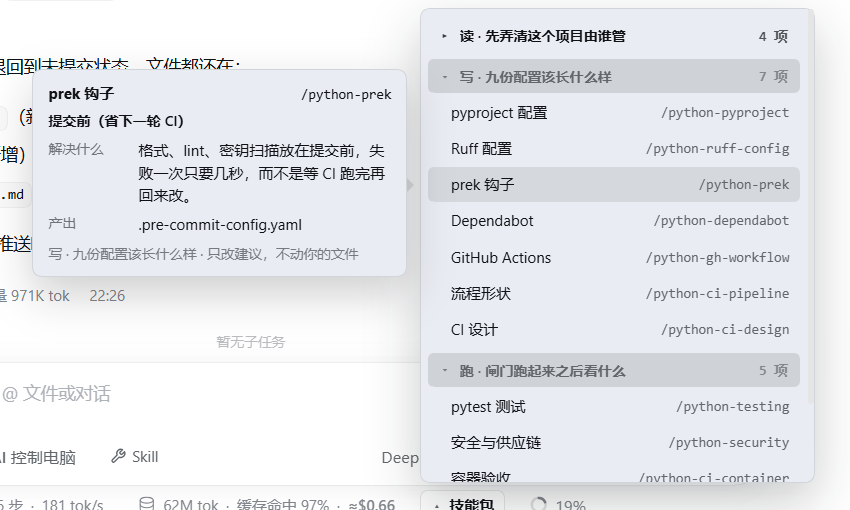
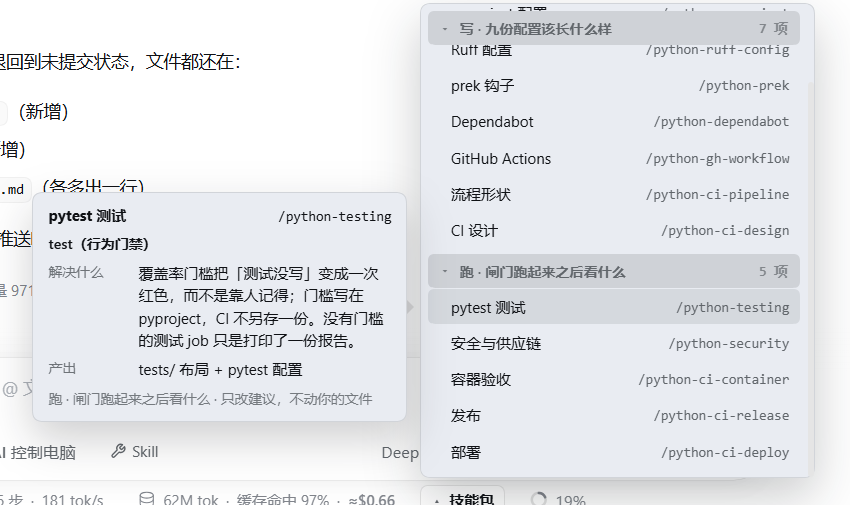

# Gatekeeper 图文说明

> 截图来自 v0.11.0 的侧栏面板与输入框胶囊，运行环境为 DeepSeek Harness 桌面端。本机路径已打码。

Gatekeeper（「门禁」）把一件事拆成三个可执行动作：**先读清这个 Python 项目是什么，再按它生成门禁配置，最后跑同一套门禁**。三个动作分别对应 `py-audit`（只读）、`py-scaffold`（生成）、`py-run`（执行）。面板从上往下就是这条线：先回答"这是什么项目"，再回答"门禁里有哪些阶段、缺哪些文件"，最后告诉你去哪里动手。

---

## 1. 面板顶部：三个数字就是全貌

标题行把整个插件说完了：**三个工具 · 十六份文档 · 13 阶段（8 默认 + 5 可选）· v0.11.0**。右上角「已就绪」表示当前会话目录探测完成；「重新检测」用于会话切换后手动刷新；「复制摘要」把整份体检复制成纯文本，方便贴给协作者。

## 2. 插件概览与三个工具：按"对项目做了什么"切分

面板从左侧栏进入。左侧栏里 Gatekeeper 是一个独立条目（和插件、SSH、MCP 连接器并列），点它就打开本页：

「插件概览」先给两条边界：用途（16 份 skill 变成可执行判据 + `/python-*` 命令）与边界（**默认不动手**——写盘与跑命令都要显式 `dryRun:false`；lockfile 被 Poetry / PDM / Pipenv 接管时一律返回 `blocked`，而不是降级改写）。

「三个工具」不是按产出哪个文件切的，是按动作切的：

- **`py-audit` 读**：一次给出哪个锁文件在管依赖、Python 版本及其来源、ruff / ty / pytest / pre-commit 配了哪些、workflow 与 13 条静态规则的结论、9 个生成目标缺了哪些、git hook 是否指向 prek。**不写盘。**
- **`py-scaffold` 写**：默认只预览九份东西（pyproject 配置表、`.pre-commit-config.yaml`、`.github/dependabot.yml`、workflow、`scripts/ci.py`、版本清单校验脚本、密钥扫描脚本、容器体检脚本等）。只有显式 `dryRun:false` 才写这九个固定路径，且绝不碰你的源码。
- **`py-run` 执行**：按 lock → sync → lint → type → manifest → test → security → build 跑闸门；`--profile commit` 走提交前快子集，`--from` 从某阶段续跑。默认只打印计划。

「入口」一节列出三种用法：左栏面板（就是本页）、输入框下方的「技能包」胶囊、直接对话（例如「给这个项目补 ruff 和 prek」）。

面板底部还有一排动作按钮，对应三个工具的只读入口：

`audit` / `scaffold` / `run` 三个按钮就是 `py-audit` / `py-scaffold` / `py-run` 的快捷方式；下方「跟随会话」下拉框决定面板看哪个目录——默认跟随当前会话，不搞独立状态。

## 3. 项目体检：它先告诉你这个项目是什么

`py-audit` 的报告是一张体检表，不是一个分数。这张表读的是一个尚无任何 Python 配置的目录：

| 字段 | 读到的 | 意思 |
| --- | --- | --- |
| 包管理器 | 未识别 | 没找到 `uv.lock`，也排除了 Poetry / PDM / Pipenv |
| 解释器 | 未声明 | `.python-version` 与 `requires-python` 都没有 |
| 依赖声明 | 无 `pyproject.toml` | 连项目元数据都还不存在 |
| 代码检查 / 测试 | 未配置 | ruff、ty、pytest 都还没进来 |
| 持续集成 | 无 `.github/workflows/` | 没有任何 workflow |
| 提交钩子 | 未安装 `prek install` | 钩子没装，提交前的 lint 与密钥扫描不会生效 |
| 镜像体检 | 6 项脚本未生成 · 只报告 | 容器检查脚本一套还没有 |
| 判定置信 | 低 | 项目信息太少，结论只能到这个程度 |

橙色提示不只报"缺什么"，还给出补齐动作：**在项目里跑一次 `prek install`**，并说明钩子写在 `.git/hooks/`，不是项目文件。下方「CI 作业」展示 workflow 里实际的 job 划分（`quality` 打底，`container` / `release` / `deploy` 逐级依赖）——没有 workflow 时这段是空的，有 workflow 时它读的就是你真实的 job 结构。

## 4. 流水线阶段：13 道闸门长什么样

「流水线阶段」是面板的核心交互：点左边的勾选框加入或移出阶段，**选中的阶段就是 workflow 与 `scripts/ci.py` 里的阶段**——本地、提交钩子、CI 三处共用同一份定义。小字标注 job、可选与未验证。每道阶段都有一句"为什么排在这个位置"的实话，例如锁文件过期就红、后面步骤不用等；代码检查是"最便宜的一道，所以排在最前面"。

往下是另外 5 道默认阶段（版本清单、测试与覆盖率、密钥扫描、构建产物、……）和 5 道可选阶段：集成测试、依赖审计要网络访问所以默认不跑；容器验收、发布、部署是独立 job 且未验证——每一项都如实标了「可选 · 交付 · 未验证」，不把没跑过的东西说成跑过的。

## 5. 生成物与取值解析：每个值从哪来

「生成物」列出 `py-scaffold` 会写盘的 9 个固定路径——右栏那句话是承诺：**不碰你的源码**。「取值解析」更进一步，把 20 项配置逐条标出来源：`existing`（项目已有）/ `detected`（探测到）/ `default`（保守默认值）。右栏那句"面板与 dry-run 看到的是同一份"是关键设计：你在面板上核对完，`py-scaffold` 写下来的就是这份，不会有两套数。

## 6. 备注与运行配置

「备注」是体检的两个直接结论：没有 `pyproject.toml` 先建它；看不出是 Python 项目的话，monorepo 请传子项目路径。「运行配置」是只读的运行时快照：默认 Python 3.13、CI 矩阵、testpaths、数据来源（会话工作目录），底部三个按钮 audit / scaffold / run 与 `跟随会话` 下拉框——面板永远跟随当前会话目录，不搞独立状态。

## 7. 技能包胶囊：十六份文档按三个工具折叠

胶囊本体长这样——它在输入框下方的状态栏里，旁边是用量统计与进度圈：

打开后是三组折叠菜单，16 份 skill 文档按工具分组：「读 · 先弄清这个项目由谁管」（4 项）、「写 · 九份配置该长什么样」（7 项）、「跑 · 闸门跑起来之后看什么」（5 项）。悬停任意一项弹出卡片，写明它解决什么、产出什么、属于哪个工具组。选中一项就把对应的 `/python-*` 命令写进输入框——注意卡片底部的小字：**只改建议，不动你的文件**。

「写」组的每一份文档对应一份会被生成的配置：`pyproject 配置`、`Ruff 配置`、`prek 钩子`、`Dependabot`、`GitHub Actions`、`流程形状`、`CI 设计`。要真正动项目，仍然要显式用 `py-scaffold`。

「跑」组是执行后的参照系：`pytest 测试` 的卡片说得很直白——覆盖率门槛把「测试没写」变成一次红色，门槛写在 pyproject、CI 不另存一份，**没有门槛的测试 job 只是打印了一份报告**。这一组文档回答的是"闸门跑起来之后，每一项结论怎么读"。

## 8. 局限

- **只服务 uv 项目**。找到 `poetry.lock`、`pdm.lock` 或 `Pipfile.lock` 时，写与跑会直接返回 `blocked` 并引用它拦下的那条规则，而不是"尽力改一改"。
- **面板是"读"的视图**。写与跑要显式调用工具（或显式 `dryRun:false`），面板不会替你决定。
- **生成的配置不替你调参数**。覆盖率门槛、规则集、依赖分组都取项目已有声明或保守默认值，是否收紧由项目自己决定。
- 截图对应 v0.11.0；面板字段以该版本为准。
